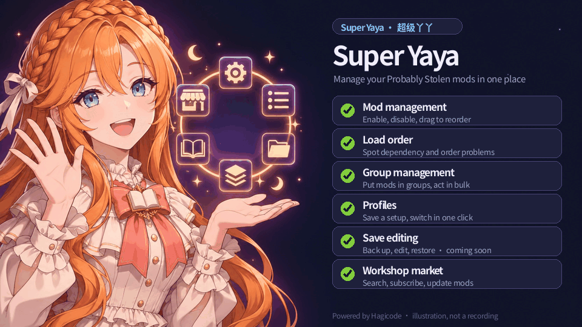
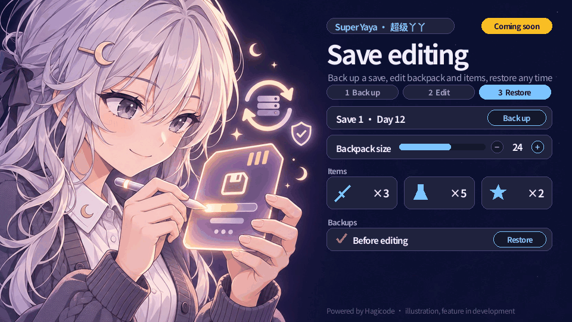

# SuperDucky.Release

[简体中文](./README_cn.md)

Public download mirror for SuperDucky (超级丫丫) releases. SuperDucky is a cross-platform desktop mod manager for Unity games. It supports Escape from Duckov and Probably Stolen (深空当铺).

**[Official site](https://sd.hagicode.com/en-US/)** · **[Microsoft Store](https://apps.microsoft.com/detail/9ndbtdkqbx30)** · **[Releases](https://github.com/HagiCode-org/SuperDucky.Release/releases)**

*The pictures on this page are animated illustrations drawn from the app's menus, not screen recordings.*

## Download

- [Microsoft Store](https://apps.microsoft.com/detail/9ndbtdkqbx30)
- [Latest and earlier versions](https://github.com/HagiCode-org/SuperDucky.Release/releases)

## A closer look

### Mod management

Enable, disable and reorder mods in one list, with drag-to-order and group ordering.

### Load order

Spot dependency and order problems before you start the game.

### Groups

Collect mods into groups and order the groups.

### Suites

Save each mod setup as a suite and switch between them.

### Market

Browse Steam Workshop mods without leaving the app.

### Save editing (coming soon)

Edit your save files from the same place. This feature is not released yet.

## Links

- Official site and documentation: <https://sd.hagicode.com/en-US/>
- Hagicode: <https://hagicode.com>
