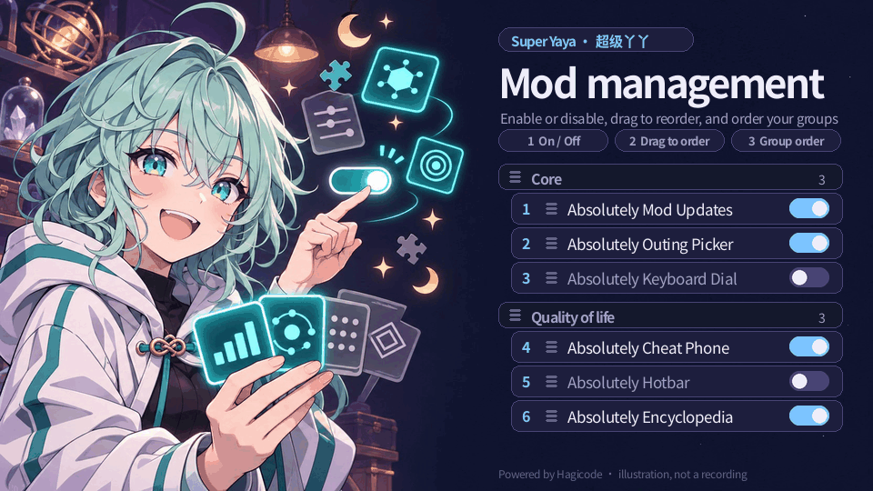
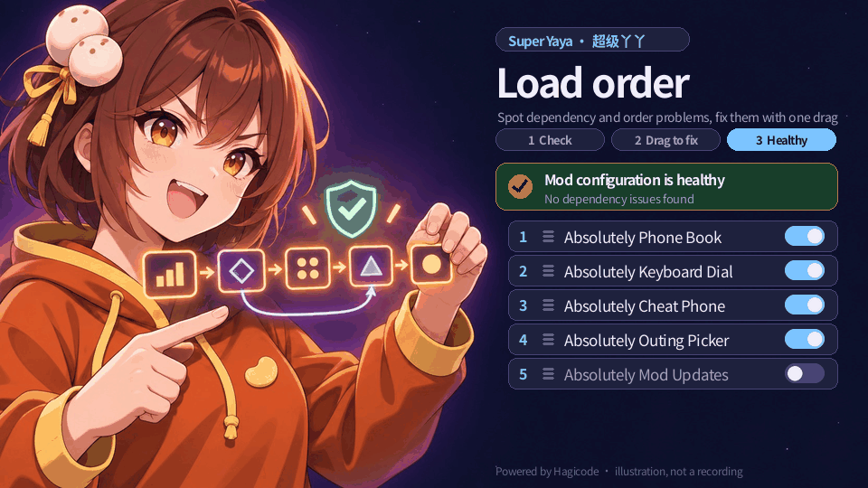
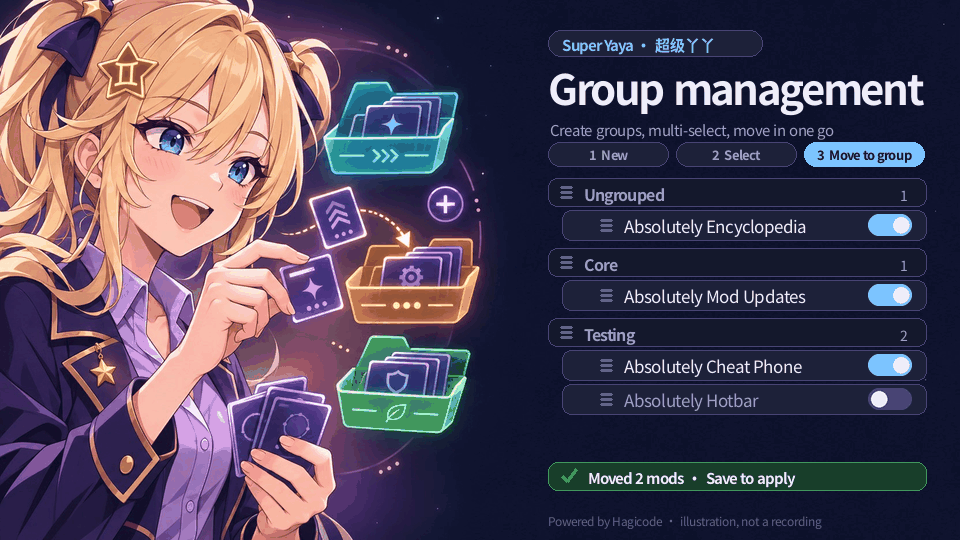
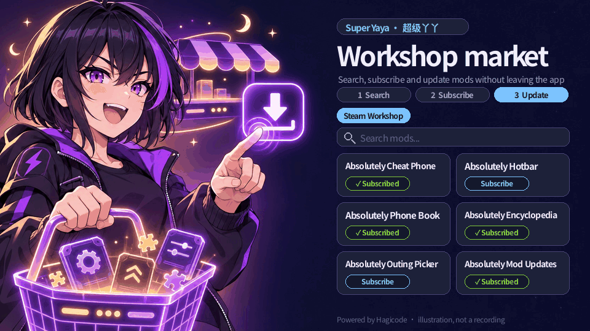

# SuperDucky.Release

[简体中文](./README_cn.md)

Public download mirror for SuperDucky (超级丫丫) releases. SuperDucky is a cross-platform desktop mod manager for PC games. It supports Escape from Duckov, Probably Stolen (深空当铺) and The Binding of Isaac (以撒的结合).

**[Official site](https://sd.hagicode.com/en-US/)** · **[Microsoft Store](https://apps.microsoft.com/detail/9ndbtdkqbx30)** · **[Releases](https://github.com/HagiCode-org/SuperDucky.Release/releases)** · **[Release site](https://sd-release.hagicode.com/)**


*The pictures on this page are animated illustrations drawn from the app's menus, not screen recordings.*

## Download

- [Microsoft Store](https://apps.microsoft.com/detail/9ndbtdkqbx30)
- [Latest and earlier versions](https://github.com/HagiCode-org/SuperDucky.Release/releases)

## A closer look

### Mod management

Enable, disable and reorder mods in one list, with drag-to-order and group ordering. The Binding of Isaac has no load order, so its mods cannot be reordered; enabling and disabling still work for it.



### Load order

Spot dependency and order problems before you start the game. This section does not apply to The Binding of Isaac, which has no load order.



### Groups

Collect mods into groups and order the groups. For The Binding of Isaac you can collect mods into groups, but the groups cannot be ordered.



### Suites

Save each mod setup as a suite and switch between them.


### Market

Browse Steam Workshop mods without leaving the app.



### Save editing (coming soon)

Edit your save files from the same place. This feature is not released yet.


## Release site

The release site at <https://sd-release.hagicode.com/> shows the latest stable release: its version, publish date, release notes and a download link for each platform. The same data is published as a machine-readable feed at <https://sd-release.hagicode.com/release.json>.

The site is an Astro project managed with pnpm. The layout:

- `scripts/fetch-latest-release.mjs` writes `src/data/release.generated.json` from the newest stable GitHub release. Drafts and prereleases are skipped. The generated file is not committed.
- `src/data/release.ts` is the only module that reads that file. The English and Chinese pages (`src/pages/`) and the feed (`src/pages/release.json.ts`) both use it, so they cannot disagree.
- `test/` holds the tests. `test/fixtures/` holds fixed GitHub API responses, so the tests never use the network.
- `.github/workflows/release-site-publish.yml` runs every 6 hours. It publishes only when the live `release.json` is missing or shows a different version than the latest stable release. A manual run can force a publish.

Commands, run from this directory (pnpm only):

```bash
pnpm install --frozen-lockfile   # install the locked dependencies
pnpm test                        # run the tests (fixtures only, no network)
pnpm run fetch:release           # write src/data/release.generated.json from the latest stable release
pnpm run build                   # fetch, build dist/ and verify the output
pnpm run dev                     # start a local development server
```

To build offline, point the fetch step at a fixture with `RELEASE_API_FIXTURE=test/fixtures/releases-valid.json pnpm run build`. That output holds test data and must not be published.

## Links

- Official site and documentation: <https://sd.hagicode.com/en-US/>
- Hagicode: <https://hagicode.com>
